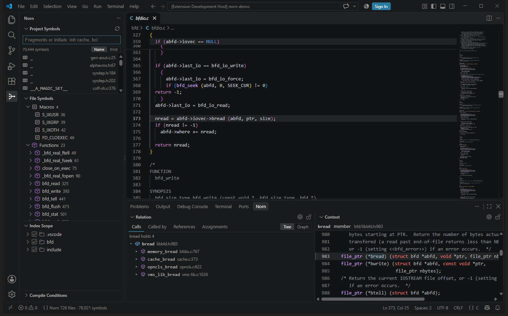
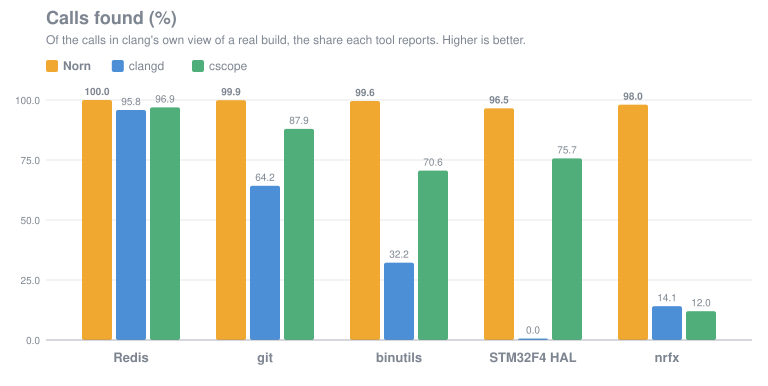
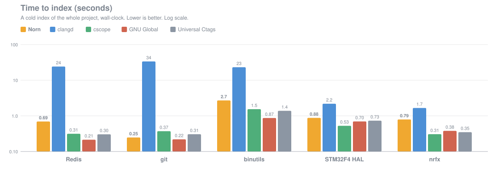
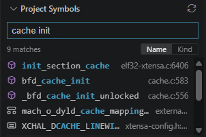
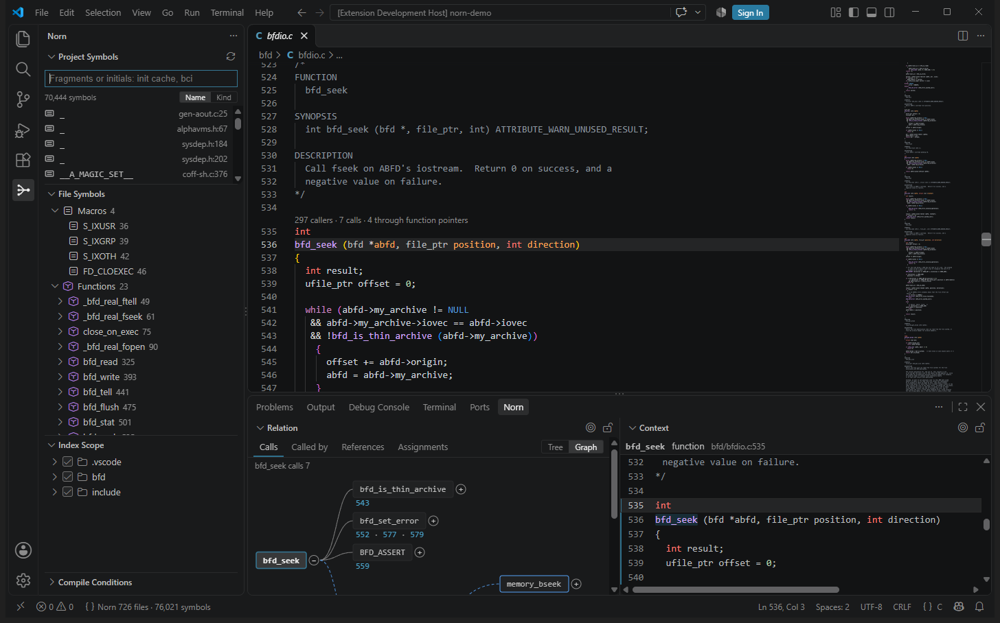
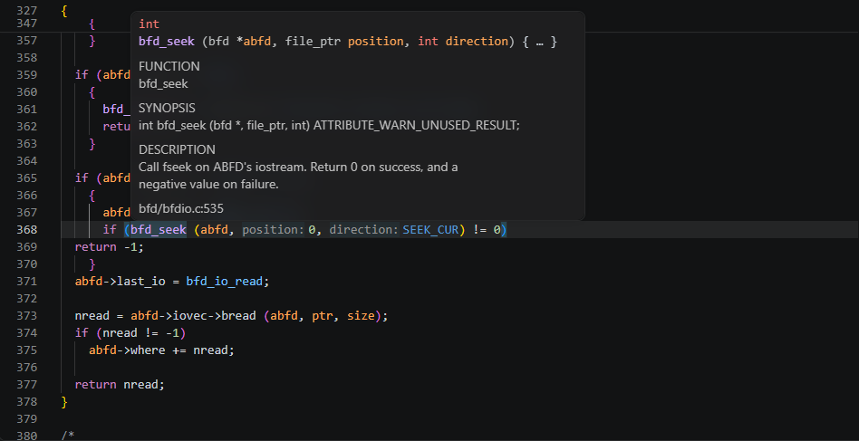
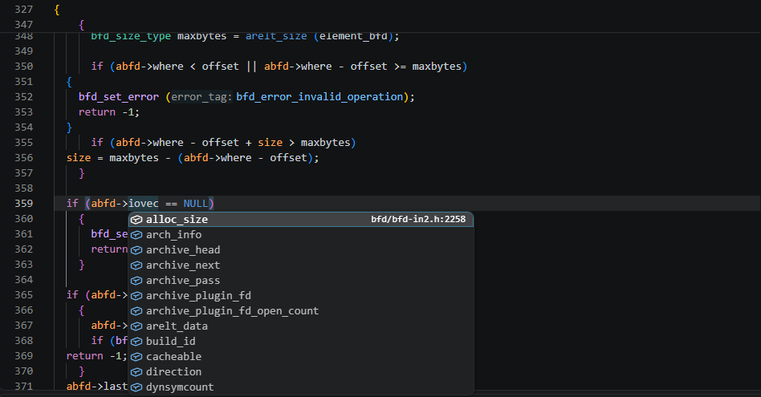
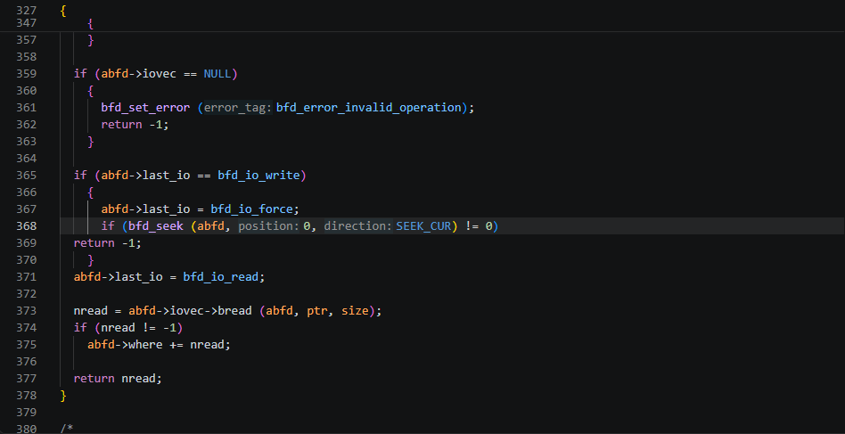
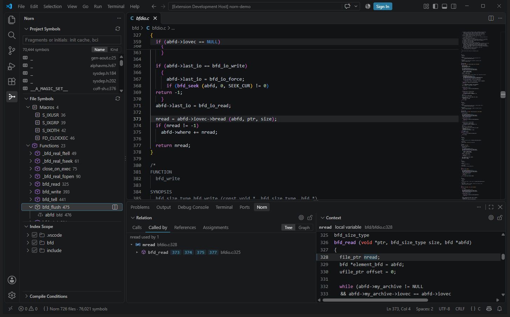

<p align="center">
  
</p>

<h1 align="center">Norn</h1>

<p align="center">
  <b>在 VS Code 裡，用 Source Insight 的方式瀏覽大型 C 專案。</b><br>
  不用編譯，不用 <code>compile_commands.json</code>。追得到透過巨集和函式指標的呼叫，只看 build 實際會編譯的程式碼。
</p>

<p align="center">
  <a href="https://github.com/humphrey0925/norn/actions/workflows/ci.yml"></a>
  <a href="LICENSE"></a>
  
  
</p>

<p align="center">
  <a href="#為什麼用-norn">為什麼用 Norn</a> ·
  <a href="#基準測試">基準測試</a> ·
  <a href="#功能">功能</a> ·
  <a href="#開始使用">開始使用</a> ·
  <a href="docs/norn-guide.md">使用指南</a> ·
  <a href="docs/cli.zh-TW.md">命令列</a> ·
  <a href="README.md">English</a>
</p>

<p align="center">
  
</p>

## 為什麼用 Norn

以編譯器為基礎的語言伺服器（例如 clangd）需要精確知道每個檔案怎麼編譯。很多實際的 C
專案很難提供這些資訊：用專屬工具鏈建置的韌體、每顆晶片一份標頭檔的 SDK、只能在某台機器上
建置的程式碼、太大或太舊而沒有可用 compilation database 的專案。ctags、cscope 這類文字索引
工具到哪裡都能用，但它們找的是名稱而不是呼叫，也分不出哪個 `#if` 分支會被編譯。

Norn 像人一樣直接讀原始碼，有 build 描述檔時也一併讀取：

- **不用設定**：開啟資料夾即可。Norn 會從 Arm DS-5、Keil、IAR、Visual Studio、CMake、
  Makefile、PlatformIO、Kconfig 或 `compile_commands.json` 找出 build 的設定，判斷哪些 `#if` 分支
  會被編譯。
- **找的是呼叫，不只是名稱**：追得到透過巨集、以及透過存在結構裡的函式指標的呼叫，並標出
  每個呼叫是怎麼發生的。
- **快到不用在意**：整個 Linux kernel 在一般桌機上大約一分鐘建好索引；存檔後幾毫秒內更新。
- **和編譯器對照過**：在公開專案上，逐一呼叫和 clang 實際編譯的結果比對（見[基準測試](#基準測試)）。
- **只在本機執行**：不連網，不收集任何資料。

| | Norn | clangd | ctags / cscope / GNU Global |
|---|:-:|:-:|:-:|
| 沒有 compilation database 也能用 | ✅ | ⚠️ 準確度較低 | ✅ |
| 知道 build 會編譯哪些 `#if` 分支 | ✅ | ✅ 需要 database | ❌ |
| 呼叫圖（呼叫者與被呼叫者） | ✅ | ✅ | ⚠️ cscope，只比對名稱 |
| 透過函式指標的呼叫 | ✅ | ❌ | ❌ |
| 由巨集產生的呼叫 | ✅ | ✅ 需要 database | ❌ |
| 存檔即更新索引 | ✅ | ✅ | ❌ 要重跑 |
| Source Insight 式的檢視（Relation、Context） | ✅ | ❌ | ❌ |

## 基準測試

在公開專案上量測，標準答案是 clang 對該專案實際 build 的結果。每個工具從零建立整個專案
的索引並計時，回報的每個呼叫都和 clang 實際編譯的呼叫對照。clangd 量了兩次：一次給它各專案真實 build 的
compilation database（clangd 的最佳狀態，也是「完全知道每個檔案怎麼編譯」的參考標準），一次什麼都不給
（沒有可用 `compile_commands.json` 的專案就是這樣）。Norn 什麼都不給。ctags、cscope、GNU Global 建索引最快，因為它們
只記錄名稱和位置，不建呼叫圖。

<!-- BENCHMARKS:BEGIN -->
<p align="center"></p>

<p align="center"></p>

| Project | Files | Norn | clangd + build database | clangd | codebase-memory-mcp | cscope | GNU Global | Universal Ctags |
|---|--:|:-:|:-:|:-:|:-:|:-:|:-:|:-:|
| Redis | 801 | **100.0%<br><sub>0.32 s</sub>** | 100.0%<br><sub>1.67 s</sub> | 95.8%<br><sub>11 s</sub> | 97.1%<br><sub>13 s</sub> | 96.9%<br><sub>0.26 s</sub> | n/a<br><sub>0.18 s</sub> | n/a<br><sub>0.17 s</sub> |
| git | 919 | **99.9%<br><sub>0.25 s</sub>** | 99.9%<br><sub>2.40 s</sub> | 64.2%<br><sub>32 s</sub> | 85.8%<br><sub>12 s</sub> | 87.9%<br><sub>0.27 s</sub> | n/a<br><sub>0.18 s</sub> | n/a<br><sub>0.17 s</sub> |
| binutils | 1,622 | **99.6%<br><sub>2.72 s</sub>** | 92.7%<br><sub>9.72 s</sub> | 32.2%<br><sub>16 s</sub> | 81.0%<br><sub>37 s</sub> | 70.6%<br><sub>1.34 s</sub> | n/a<br><sub>0.81 s</sub> | n/a<br><sub>0.99 s</sub> |
| STM32F4 HAL | 253 | **96.5%<br><sub>0.64 s</sub>** | 95.0%<br><sub>3.14 s</sub> | 0.0%<br><sub>1.14 s</sub> | 85.8%<br><sub>9.62 s</sub> | 75.7%<br><sub>0.44 s</sub> | n/a<br><sub>0.68 s</sub> | n/a<br><sub>0.60 s</sub> |
| nrfx | 535 | **98.0%<br><sub>0.84 s</sub>** | 100.0%<br><sub>1.15 s</sub> | 14.1%<br><sub>1.22 s</sub> | 94.2%<br><sub>8.29 s</sub> | 12.0%<br><sub>0.28 s</sub> | n/a<br><sub>0.36 s</sub> | n/a<br><sub>0.32 s</sub> |

<sub>每格：找到的呼叫比例（和 clang 對照），下方為建立索引的時間。</sub>

<sub>clangd 在 binutils、STM32F4 HAL、nrfx：只給它沒有 include 路徑、沒有 <code>-D</code> 的條件（沒有 compilation database 的專案能給的就這些），需要 build 的標頭檔路徑或定義才能解析的原始碼，它大多解析不了。有真正 build 的 database 時它會好很多，但這裡量的不是那種情況。</sub>
<!-- BENCHMARKS:END -->

量測方法、每個專案的完整數字、各工具的版本：見 [docs/benchmarks](docs/benchmarks/README.md)（英文）。
那裡的每個數字都由 [`bench/compare.py`](bench/compare.py) 產生，沒有任何手打的數字。
要從零重新量一次（EC2 或任何 Ubuntu 24.04）：見 [bench/ec2](bench/ec2/README.md)。

## 功能

<table>
  <tr>
    <td width="50%"><b>Project Symbols</b><br>模糊搜尋所有符號：片段順序不拘、縮寫、依序出現的字母都可以。<br></td>
    <td width="50%"><b>Relation</b><br>呼叫者、被呼叫者、參考位置、函式指標的指派位置，可用樹狀或關係圖檢視。<br></td>
  </tr>
  <tr>
    <td><b>附文件的懸停</b><br>顯示宣告和文件註解；巨集會一路展開算出值。<br></td>
    <td><b>Context</b><br>在程式碼旁邊顯示游標所在名稱的定義，不用離開目前位置。<br></td>
  </tr>
  <tr>
    <td><b>自動完成</b><br><code>.</code>、<code>-></code> 後的成員、區域變數、關鍵字、<code>#include</code> 路徑、所有索引到的名稱。<br></td>
    <td><b>上色與提示</b><br>依名稱種類上色；呼叫處顯示參數名稱。<br></td>
  </tr>
  <tr>
    <td><b>File Symbols 與區域變數</b><br>函式的參數和區域變數，以及每個用到它的行。<br></td>
    <td><b>編譯條件</b><br>從 build 讀取設定組，在 Debug、Release 或各板子的設定之間切換。<br></td>
  </tr>
</table>

Norn 是完整的語言伺服器：移至定義、尋找參考、呼叫階層、參數提示、重新命名、摺疊、格式化、
快速修正都有。和微軟的 C/C++ 擴充套件一起使用時，Norn 會成為 IntelliSense 的
configuration provider，而不是和它重複。完整功能列表見[擴充套件頁面](vscode/README.md)（英文）。

## 開始使用

1. 從 Visual Studio Marketplace 或 Open VSX 安裝 **Norn — Code Navigation & Symbol Index**，
   或從 [releases](https://github.com/humphrey0925/norn/releases) 下載 `.vsix`。
2. 開啟一個有 C 原始碼的資料夾。

這樣就好了。擴充套件已內含 Windows、Linux、macOS（x64 與 Arm64）的伺服器。每個檢視和設定的
說明見[使用指南](docs/norn-guide.md)。

不用 VS Code 時，同一個索引程式也是獨立的指令 `norn`，可在終端機、腳本、CI 和其他編輯器（作為
語言伺服器）使用：見[命令列手冊](docs/cli.zh-TW.md)。

## 運作原理

```
原始碼 ─► tree-sitter 解析 ─► 每個檔案的事實 ─► 連結 ─► 呼叫圖（CSR）─► 語言伺服器
             ▲                                  ▲
   依 build 自己的設定和原始碼               解析透過巨集與
   判斷 #if                                 函式指標的呼叫
```

Norn 用 Rust 寫成。每個檔案先依 build 的設定和原始碼自己的定義判斷前置處理器條件，再用
tree-sitter 解析一次。每個檔案的結果依內容雜湊快取，開啟的資料夾若在已建過索引的資料夾裡面或外面，讀法相同的檔案
直接沿用那份結果；把它們連結成呼叫圖只要幾毫秒，所以存檔後
索引幾乎立刻更新。呼叫圖以壓縮稀疏列（CSR）儲存，查一個函式的呼叫者遠不到一微秒。

## 從原始碼建置

需要 Rust（stable）和 Node.js 20。

```bash
cargo build --release
```

```bash
cd vscode && npm ci && npm run compile
```

| 路徑 | |
|---|---|
| [`crates/si-core`](crates/si-core) | 索引本體：解析、前置處理器條件、連結、儲存的圖 |
| [`crates/si-cli`](crates/si-cli) | `norn` 執行檔：`norn lsp`（語言伺服器）、`norn index`、`norn query` |
| [`vscode`](vscode) | VS Code 擴充套件 |
| [`bench`](bench) | 和 clang 及其他索引工具比較準確度與速度的量測 |

正式發佈由 GitHub Actions 在 Windows、Linux、macOS 上建置與測試，流程見
[docs/releasing.md](docs/releasing.md)。

## 參與貢獻

歡迎提出 issue 和 pull request，請見 [CONTRIBUTING.md](CONTRIBUTING.md)。貢獻需同意
[貢獻者授權協議（CLA）](CLA.md)：第一次送 pull request 時，CLA 檢查會請你簽署。

## 授權

Copyright 2026 humphrey0925 and the Norn contributors。以
[Apache License 2.0](LICENSE) 授權。
