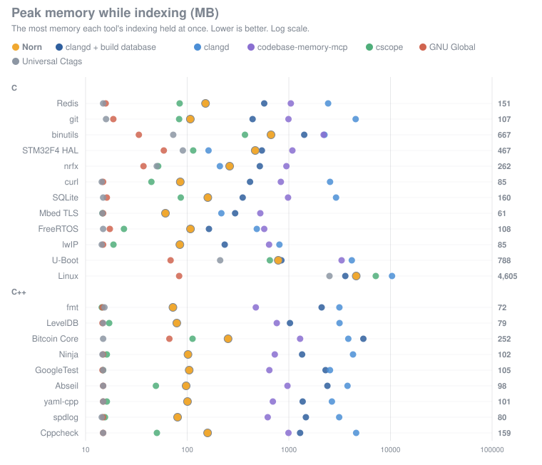

# Benchmarks

Norn against other ways of indexing C and C++, on public projects. Every number here is produced by
`bench/compare.py` and turned into this page by `bench/chart.py`; nothing is typed in.

## How it is measured

- **Ground truth**: clang's own view of each project, compiled with its real build
  (`bench/gt_extract.py`): every function definition, and every call with the function it
  reaches. A tool's *calls found* is the share of those calls it reports with the right target;
  *precision* is the share of the calls it reports as certain that are right.
- **Index**: an index of the whole project from nothing (the files already in the OS cache),
  wall-clock, with peak memory and the size on disk.
- **Update**: the time to bring the index up to date after one file is edited.
- **Queries**: median latency of finding a symbol by name and of listing a function's callers,
  each tool queried the way it is meant to be (a warm server where it has one).
- **clangd** is given a compilation database with no include paths and no `-D`: what a project
  without a working `compile_commands.json` gives it. With a real build's database it would be
  slower to index and more accurate.
- **clangd + build database** is clangd at its best: given each project's own `compile_commands.json`
  (the one its ground truth was made from), on the tree that build was made in. It runs in WSL 2
  (Linux, clangd 20) because those builds are Linux builds. It is the reference for what a
  compiler-based index finds when it is told exactly how every file is compiled.
- clangd's accuracy is measured on a sample of the functions clang saw (callers and callees of each
  through its call hierarchy); the other tools' on every call.
- ctags records definitions only, and GNU Global references to a name rather than calls from a
  function, so neither has a figure for calls.
- **Norn** is given nothing: no configuration, no include paths, no `-D`. Where a project's
  `#if`s leave many calls uncertain without one (FreeRTOS, spdlog, Linux), it is measured again
  given the build's configuration, as a user would give it (*Norn + build configuration*, on
  those projects' pages only).
- Norn marks a call it cannot be sure of (under an `#if` the configuration does not settle) as
  uncertain. *Calls found* counts every call a tool reports; *of them certain* counts only the
  ones it reports as certain, and *precision* is measured on those. The other tools mark none.
- Norn, clangd and codebase-memory-mcp run on Windows (NTFS); ctags, cscope and GNU Global, which
  are Unix tools, run in WSL 2 on a copy of each project on its ext4 file system.
- Each tool indexes each project three times; the median is reported.
- To measure it all again from nothing, on EC2 or any Ubuntu 24.04: [bench/ec2](../../bench/ec2/README.md).

Machine: Intel64 Family 6 Model 183 Stepping 1, GenuineIntel, 20 cores, 64 GB RAM, Windows-10-10.0.26200-SP0. Measured 2026-10-24.

## Redis

801 files, 392,046 lines.

| Tool | Index | Peak memory | On disk | Update after an edit | Find | Callers | Definitions found | Calls found | of them certain | Call precision |
|---|--:|--:|--:|--:|--:|--:|--:|--:|--:|--:|
| **Norn** | 0.33 s | 151 MB | 7 MB | 0.01 s | 0.02 ms | 0.02 ms | 100.0% | 100.0% | 99.3% | 99.8% |
| clangd + build database | 2.71 s | 573 MB | 8 MB | 0.32 s | 0.55 ms | 32 ms | 100.0% | 100.0% | 100.0% | 97.1% |
| clangd | 15 s | 2,435 MB | 14 MB | 0.69 s | 0.48 ms | 34 ms | 97.4% | 95.8% | 95.8% | 96.0% |
| codebase-memory-mcp | 15 s | 1,046 MB | 135 MB | 6.90 s | 28 ms | 34 ms | 100.0% | 97.1% | 97.1% | 97.3% |
| cscope | 0.28 s | 84 MB | 23 MB | 0.16 s | 0.81 ms | 0.79 ms | 99.9% | 96.9% | 91.2% | 98.0% |
| GNU Global | 0.20 s | 16 MB | 8 MB | 0.04 s | 0.78 ms | 0.94 ms | 99.8% | – | – | – |
| Universal Ctags | 0.18 s | 15 MB | 4 MB | – | 0.42 ms | – | 100.0% | – | – | – |

Versions: clangd + build database 20.1.2; clangd 21.1.0; codebase-memory-mcp 0.11.0; cscope 15.9; GNU Global 6.6.11; Universal Ctags 5.9.0.

## git

919 files, 412,932 lines.

| Tool | Index | Peak memory | On disk | Update after an edit | Find | Callers | Definitions found | Calls found | of them certain | Call precision |
|---|--:|--:|--:|--:|--:|--:|--:|--:|--:|--:|
| **Norn** | 0.26 s | 107 MB | 5 MB | 0.01 s | 0.02 ms | 0.02 ms | 100.0% | 99.9% | 99.6% | 99.6% |
| clangd + build database | 2.42 s | 440 MB | 7 MB | 0.30 s | 0.36 ms | 19 ms | 99.6% | 99.9% | 99.9% | 88.1% |
| clangd | 34 s | 4,542 MB | 14 MB | 1.26 s | 0.38 ms | 32 ms | 99.2% | 64.2% | 64.2% | 80.6% |
| codebase-memory-mcp | 12 s | 992 MB | 119 MB | 5.68 s | 29 ms | 34 ms | 96.9% | 85.9% | 85.9% | 99.7% |
| cscope | 0.28 s | 83 MB | 23 MB | 0.16 s | 0.80 ms | 0.77 ms | 97.0% | 87.9% | 79.3% | 99.9% |
| GNU Global | 0.21 s | 19 MB | 9 MB | 0.03 s | 0.78 ms | 0.85 ms | 96.8% | – | – | – |
| Universal Ctags | 0.17 s | 16 MB | 3 MB | – | 0.41 ms | – | 96.9% | – | – | – |

Versions: clangd + build database 20.1.2; clangd 21.1.0; codebase-memory-mcp 0.11.0; cscope 15.9; GNU Global 6.6.11; Universal Ctags 5.9.0.

## binutils

1,622 files, 2,145,473 lines.

| Tool | Index | Peak memory | On disk | Update after an edit | Find | Callers | Definitions found | Calls found | of them certain | Call precision |
|---|--:|--:|--:|--:|--:|--:|--:|--:|--:|--:|
| **Norn** | 2.56 s | 667 MB | 43 MB | 0.07 s | 0.02 ms | 0.02 ms | 100.0% | 99.6% | 95.5% | 99.7% |
| clangd + build database | 9.65 s | 1,418 MB | 38 MB | 1.53 s | 0.51 ms | 23 ms | 99.9% | 92.7% | 92.7% | 80.3% |
| clangd | 22 s | 2,242 MB | 24 MB | 1.29 s | 0.45 ms | 34 ms | 96.9% | 32.3% | 32.3% | 63.7% |
| codebase-memory-mcp | 38 s | 2,200 MB | 400 MB | 7.76 s | 46 ms | 47 ms | 94.1% | 81.0% | 81.0% | 97.1% |
| cscope | 1.40 s | 370 MB | 118 MB | 0.73 s | 0.79 ms | 0.79 ms | 94.2% | 70.6% | 64.9% | 89.8% |
| GNU Global | 0.87 s | 33 MB | 38 MB | 0.06 s | 0.80 ms | 1.03 ms | 96.3% | – | – | – |
| Universal Ctags | 1.03 s | 73 MB | 21 MB | – | 0.47 ms | – | 96.5% | – | – | – |

clangd is given no include paths and no `-D`, as a project without a compilation database would: most of the code that needs the build's include paths or definitions does not parse for it. With a real build's database it does far better; that is not what is measured here.

Versions: clangd + build database 20.1.2; clangd 21.1.0; codebase-memory-mcp 0.11.0; cscope 15.9; GNU Global 6.6.11; Universal Ctags 5.9.0.

## STM32F4 HAL

253 files, 639,267 lines.

| Tool | Index | Peak memory | On disk | Update after an edit | Find | Callers | Definitions found | Calls found | of them certain | Call precision |
|---|--:|--:|--:|--:|--:|--:|--:|--:|--:|--:|
| **Norn** | 0.67 s | 467 MB | 16 MB | 0.13 s | 0.02 ms | 0.02 ms | 99.4% | 96.5% | 96.5% | 100.0% |
| clangd + build database | 2.82 s | 543 MB | 2 MB | 1.00 s | 0.29 ms | 108 ms | 100.0% | 95.0% | 95.0% | 86.8% |
| clangd | 1.86 s | 162 MB | 0 MB | 0.08 s | 0.22 ms | 15 ms | 4.1% | 0.0% | 0.0% | 0.0% |
| codebase-memory-mcp | 10 s | 1,083 MB | 413 MB | 6.96 s | 64 ms | 60 ms | 99.7% | 85.8% | 85.8% | 98.1% |
| cscope | 0.46 s | 115 MB | 40 MB | 0.21 s | 0.77 ms | 0.76 ms | 54.5% | 75.7% | 74.3% | 97.7% |
| GNU Global | 0.72 s | 59 MB | 61 MB | 0.06 s | 0.78 ms | 0.89 ms | 100.0% | – | – | – |
| Universal Ctags | 0.63 s | 91 MB | 40 MB | – | 0.46 ms | – | 100.0% | – | – | – |

clangd is given no include paths and no `-D`, as a project without a compilation database would: most of the code that needs the build's include paths or definitions does not parse for it. With a real build's database it does far better; that is not what is measured here.

Versions: clangd + build database 20.1.2; clangd 21.1.0; codebase-memory-mcp 0.11.0; cscope 15.9; GNU Global 6.6.11; Universal Ctags 5.9.0.

## nrfx

535 files, 532,196 lines.

| Tool | Index | Peak memory | On disk | Update after an edit | Find | Callers | Definitions found | Calls found | of them certain | Call precision |
|---|--:|--:|--:|--:|--:|--:|--:|--:|--:|--:|
| **Norn** | 0.58 s | 262 MB | 10 MB | 0.02 s | 0.02 ms | 0.02 ms | 99.2% | 99.4% | 97.8% | 99.8% |
| clangd + build database | 1.12 s | 518 MB | 1 MB | 1.05 s | 0.24 ms | 99 ms | 100.0% | 100.0% | 100.0% | 100.0% |
| clangd | 1.59 s | 210 MB | 0 MB | 0.09 s | 0.22 ms | 22 ms | 100.0% | 14.1% | 14.1% | 100.0% |
| codebase-memory-mcp | 8.65 s | 947 MB | 202 MB | 6.21 s | 48 ms | 45 ms | 96.2% | 94.2% | 94.2% | 97.2% |
| cscope | 0.31 s | 52 MB | 24 MB | 0.15 s | 0.89 ms | 0.90 ms | 35.8% | 12.0% | 10.9% | 79.5% |
| GNU Global | 0.41 s | 37 MB | 29 MB | 0.04 s | 0.79 ms | 0.83 ms | 100.0% | – | – | – |
| Universal Ctags | 0.36 s | 50 MB | 23 MB | – | 0.46 ms | – | 100.0% | – | – | – |

clangd is given no include paths and no `-D`, as a project without a compilation database would: most of the code that needs the build's include paths or definitions does not parse for it. With a real build's database it does far better; that is not what is measured here.

Versions: clangd + build database 20.1.2; clangd 21.1.0; codebase-memory-mcp 0.11.0; cscope 15.9; GNU Global 6.6.11; Universal Ctags 5.9.0.

## curl

1,067 files, 301,014 lines.

| Tool | Index | Peak memory | On disk | Update after an edit | Find | Callers | Definitions found | Calls found | of them certain | Call precision |
|---|--:|--:|--:|--:|--:|--:|--:|--:|--:|--:|
| **Norn** | 0.34 s | 85 MB | 4 MB | 0.01 s | 0.03 ms | 0.03 ms | 96.9% | 89.6% | 80.4% | 99.6% |
| clangd + build database | 1.12 s | 415 MB | 5 MB | 0.15 s | 0.30 ms | 12 ms | 100.0% | 100.0% | 100.0% | 97.2% |
| clangd | 22 s | 2,547 MB | 11 MB | 0.49 s | 0.29 ms | 52 ms | 83.0% | 45.4% | 45.4% | 85.6% |
| codebase-memory-mcp | 9.74 s | 834 MB | 88 MB | 6.46 s | 29 ms | 33 ms | 97.6% | 78.5% | 78.5% | 98.7% |
| cscope | 0.20 s | 44 MB | 15 MB | 0.10 s | 0.78 ms | 0.78 ms | 98.1% | 78.7% | 74.2% | 97.5% |
| GNU Global | 0.15 s | 15 MB | 6 MB | 0.03 s | 0.78 ms | 0.84 ms | 98.3% | – | – | – |
| Universal Ctags | 0.12 s | 14 MB | 2 MB | – | 0.44 ms | – | 98.3% | – | – | – |

clangd is given no include paths and no `-D`, as a project without a compilation database would: most of the code that needs the build's include paths or definitions does not parse for it. With a real build's database it does far better; that is not what is measured here.

Versions: clangd + build database 20.1.2; clangd 21.1.0; codebase-memory-mcp 0.11.0; cscope 15.9; GNU Global 6.6.11; Universal Ctags 5.9.0.

## SQLite

360 files, 461,806 lines.

| Tool | Index | Peak memory | On disk | Update after an edit | Find | Callers | Definitions found | Calls found | of them certain | Call precision |
|---|--:|--:|--:|--:|--:|--:|--:|--:|--:|--:|
| **Norn** | 0.26 s | 160 MB | 7 MB | 0.01 s | 0.02 ms | 0.02 ms | 97.1% | 93.9% | 92.2% | 95.3% |
| clangd + build database | 0.64 s | 352 MB | 4 MB | 0.12 s | 0.46 ms | 48 ms | 99.8% | 99.2% | 99.2% | 93.0% |
| clangd | 15 s | 2,913 MB | 12 MB | 0.55 s | 0.46 ms | 67 ms | 90.5% | 74.5% | 74.5% | 76.8% |
| codebase-memory-mcp | 12 s | 983 MB | 118 MB | 6.19 s | 28 ms | 34 ms | 98.6% | 90.8% | 90.8% | 86.4% |
| cscope | 0.29 s | 86 MB | 24 MB | 0.16 s | 0.75 ms | 0.74 ms | 84.2% | 83.6% | 81.8% | 95.3% |
| GNU Global | 0.19 s | 16 MB | 7 MB | 0.02 s | 0.81 ms | 0.98 ms | 99.9% | – | – | – |
| Universal Ctags | 0.19 s | 15 MB | 3 MB | – | 0.42 ms | – | 99.9% | – | – | – |

Versions: clangd + build database 20.1.2; clangd 21.1.0; codebase-memory-mcp 0.11.0; cscope 15.9; GNU Global 6.6.11; Universal Ctags 5.9.0.

## Mbed TLS

131 files, 87,389 lines.

| Tool | Index | Peak memory | On disk | Update after an edit | Find | Callers | Definitions found | Calls found | of them certain | Call precision |
|---|--:|--:|--:|--:|--:|--:|--:|--:|--:|--:|
| **Norn** | 0.11 s | 61 MB | 1 MB | 0.01 s | 0.02 ms | 0.02 ms | 99.1% | 89.8% | 71.7% | 99.0% |
| clangd + build database | 0.40 s | 296 MB | 2 MB | 0.11 s | 0.28 ms | 20 ms | 94.9% | 99.3% | 99.3% | 32.5% |
| clangd | 1.54 s | 217 MB | 0 MB | 0.13 s | 0.24 ms | 15 ms | 1.0% | 0.0% | 0.0% | 0.0% |
| codebase-memory-mcp | 5.43 s | 524 MB | 19 MB | 4.93 s | 15 ms | 16 ms | 97.5% | 68.1% | 68.1% | 100.0% |
| cscope | 0.06 s | 15 MB | 4 MB | 0.03 s | 0.76 ms | 0.77 ms | 91.2% | 69.0% | 67.6% | 98.6% |
| GNU Global | 0.05 s | 15 MB | 2 MB | 0.02 s | 0.78 ms | 0.86 ms | 98.5% | – | – | – |
| Universal Ctags | 0.04 s | 15 MB | 1 MB | – | 0.41 ms | – | 98.7% | – | – | – |

clangd is given no include paths and no `-D`, as a project without a compilation database would: most of the code that needs the build's include paths or definitions does not parse for it. With a real build's database it does far better; that is not what is measured here.

Versions: clangd + build database 20.1.2; clangd 21.1.0; codebase-memory-mcp 0.11.0; cscope 15.9; GNU Global 6.6.11; Universal Ctags 5.9.0.

## FreeRTOS

655 files, 349,140 lines.

| Tool | Index | Peak memory | On disk | Update after an edit | Find | Callers | Definitions found | Calls found | of them certain | Call precision |
|---|--:|--:|--:|--:|--:|--:|--:|--:|--:|--:|
| **Norn** | 0.34 s | 108 MB | 6 MB | 0.02 s | 0.02 ms | 0.02 ms | 100.0% | 98.6% | 46.5% | 100.0% |
| **Norn + build configuration** | 0.32 s | 100 MB | 8 MB | 0.02 s | 0.02 ms | 0.03 ms | 100.0% | 99.5% | 84.3% | 100.0% |
| clangd + build database | 0.11 s | 164 MB | 0 MB | 0.05 s | 0.24 ms | 6.48 ms | 100.0% | 100.0% | 100.0% | 91.7% |
| clangd | 5.57 s | 484 MB | 6 MB | 0.36 s | 0.23 ms | 16 ms | 56.5% | 9.1% | 9.1% | 57.1% |
| codebase-memory-mcp | 9.17 s | 573 MB | 99 MB | 6.33 s | 29 ms | 34 ms | 98.2% | 48.1% | 48.1% | 95.3% |
| cscope | 0.21 s | 24 MB | 12 MB | 0.10 s | 0.79 ms | 0.77 ms | 99.1% | 50.6% | 43.3% | 87.7% |
| GNU Global | 0.18 s | 17 MB | 10 MB | 0.04 s | 0.79 ms | 0.96 ms | 97.8% | – | – | – |
| Universal Ctags | 0.19 s | 15 MB | 5 MB | – | 0.57 ms | – | 99.1% | – | – | – |

clangd is given no include paths and no `-D`, as a project without a compilation database would: most of the code that needs the build's include paths or definitions does not parse for it. With a real build's database it does far better; that is not what is measured here.

Norn + build configuration: Norn given the folders and files its build does not compile (the other ports, the other heap implementations and the other example configuration) as `notBuilt` in `.norn/config.json`, worked out from the build's `compile_commands.json`. Everywhere else Norn is given nothing.

Versions: clangd + build database 20.1.2; clangd 21.1.0; codebase-memory-mcp 0.11.0; cscope 15.9; GNU Global 6.6.11; Universal Ctags 5.9.0.

## lwIP

480 files, 173,225 lines.

| Tool | Index | Peak memory | On disk | Update after an edit | Find | Callers | Definitions found | Calls found | of them certain | Call precision |
|---|--:|--:|--:|--:|--:|--:|--:|--:|--:|--:|
| **Norn** | 0.16 s | 85 MB | 2 MB | 0.01 s | 0.03 ms | 0.03 ms | 97.2% | 80.5% | 67.1% | 94.9% |
| clangd + build database | 0.48 s | 234 MB | 2 MB | 0.14 s | 0.28 ms | 18 ms | 98.2% | 96.6% | 96.6% | 90.7% |
| clangd | 4.44 s | 807 MB | 5 MB | 0.29 s | 0.23 ms | 16 ms | 14.0% | 0.8% | 0.8% | 75.0% |
| codebase-memory-mcp | 6.20 s | 639 MB | 42 MB | 5.18 s | 27 ms | 28 ms | 98.0% | 68.8% | 68.8% | 94.7% |
| cscope | 0.11 s | 19 MB | 8 MB | 0.06 s | 0.79 ms | 0.77 ms | 98.1% | 75.1% | 68.2% | 96.7% |
| GNU Global | 0.09 s | 15 MB | 3 MB | 0.02 s | 0.79 ms | 0.85 ms | 99.9% | – | – | – |
| Universal Ctags | 0.07 s | 14 MB | 2 MB | – | 0.40 ms | – | 98.8% | – | – | – |

clangd is given no include paths and no `-D`, as a project without a compilation database would: most of the code that needs the build's include paths or definitions does not parse for it. With a real build's database it does far better; that is not what is measured here.

Versions: clangd + build database 20.1.2; clangd 21.1.0; codebase-memory-mcp 0.11.0; cscope 15.9; GNU Global 6.6.11; Universal Ctags 5.9.0.

## U-Boot

13,352 files, 4,015,428 lines.

| Tool | Index | Peak memory | On disk | Update after an edit | Find | Callers | Definitions found | Calls found | of them certain | Call precision |
|---|--:|--:|--:|--:|--:|--:|--:|--:|--:|--:|
| **Norn** | 5.54 s | 788 MB | 103 MB | 0.29 s | 0.02 ms | 0.02 ms | 99.2% | 94.9% | 74.8% | 96.8% |
| clangd + build database | 4.09 s | 845 MB | 16 MB | 0.78 s | 0.28 ms | 16 ms | 99.6% | 96.4% | 96.4% | 92.7% |
| clangd | 150 s | 4,163 MB | 30 MB | 2.46 s | 0.26 ms | 22 ms | 87.9% | 19.9% | 19.9% | 71.3% |
| codebase-memory-mcp | 65 s | 3,306 MB | 1,685 MB | 26 s | 149 ms | 100 ms | 94.3% | 65.5% | 65.5% | 89.2% |
| cscope | 3.22 s | 651 MB | 220 MB | 2.11 s | 1.08 ms | 1.07 ms | 93.9% | 76.2% | 60.0% | 91.6% |
| GNU Global | 1.98 s | 69 MB | 109 MB | 0.28 s | 0.75 ms | 0.79 ms | 94.6% | – | – | – |
| Universal Ctags | 2.02 s | 211 MB | 103 MB | – | 0.40 ms | – | 94.6% | – | – | – |

clangd is given no include paths and no `-D`, as a project without a compilation database would: most of the code that needs the build's include paths or definitions does not parse for it. With a real build's database it does far better; that is not what is measured here.

Versions: clangd + build database 20.1.2; clangd 21.1.0; codebase-memory-mcp 0.11.0; cscope 15.9; GNU Global 6.6.11; Universal Ctags 5.9.0.

## Linux

64,574 files, 37,757,234 lines.

| Tool | Index | Peak memory | On disk | Update after an edit | Find | Callers | Definitions found | Calls found | of them certain | Call precision |
|---|--:|--:|--:|--:|--:|--:|--:|--:|--:|--:|
| **Norn** | 64 s | 4,605 MB | 1,188 MB | 1.96 s | 0.02 ms | 0.02 ms | 92.1% | 91.1% | 64.7% | 99.0% |
| **Norn + build configuration** | 80 s | 5,511 MB | 906 MB | 1.89 s | 0.02 ms | 0.02 ms | 99.7% | 98.5% | 95.8% | 99.1% |
| clangd + build database | 113 s | 3,599 MB | 91 MB | 2.73 s | 0.59 ms | 60 ms | 99.8% | 99.6% | 99.6% | 89.0% |
| clangd | 1026 s | 10,367 MB | 361 MB | 28 s | 0.61 ms | 30 ms | 85.8% | 18.8% | 18.8% | 66.2% |
| cscope | 56 s | 7,167 MB | 2,463 MB | 44 s | 2.65 ms | 2.58 ms | 74.4% | 63.9% | 47.2% | 91.4% |
| GNU Global | 23 s | 83 MB | 1,556 MB | 1.79 s | 0.79 ms | 0.88 ms | 74.3% | – | – | – |
| Universal Ctags | 26 s | 2,511 MB | 1,412 MB | – | 0.45 ms | – | 74.4% | – | – | – |

codebase-memory-mcp: did not finish (RuntimeError: codebase-memory-mcp.exe exited with 1).

clangd is given no include paths and no `-D`, as a project without a compilation database would: most of the code that needs the build's include paths or definitions does not parse for it. With a real build's database it does far better; that is not what is measured here.

Norn + build configuration: Norn given the build's Kconfig configuration (`include/generated/autoconf.h` of its defconfig), which Norn follows unasked. Everywhere else Norn is given nothing.

Versions: clangd + build database 20.1.2; clangd 21.1.0; cscope 15.9; GNU Global 6.6.11; Universal Ctags 5.9.0.

## fmt

72 files, 69,004 lines.

| Tool | Index | Peak memory | On disk | Update after an edit | Find | Callers | Definitions found | Calls found | of them certain | Call precision |
|---|--:|--:|--:|--:|--:|--:|--:|--:|--:|--:|
| **Norn** | 0.20 s | 72 MB | 2 MB | 0.01 s | 0.02 ms | 0.02 ms | 96.2% | 89.9% | 79.6% | 97.3% |
| clangd + build database | 3.88 s | 2,104 MB | 5 MB | 0.25 s | 0.22 ms | 0.29 ms | 76.2% | 91.6% | 91.6% | 96.7% |
| clangd | 13 s | 3,145 MB | 9 MB | 0.41 s | 0.22 ms | 0.21 ms | 65.3% | 68.1% | 68.1% | 99.4% |
| codebase-memory-mcp | 6.24 s | 473 MB | 26 MB | 4.87 s | 27 ms | 27 ms | 29.0% | 9.2% | 9.2% | 94.7% |
| cscope | 0.06 s | 14 MB | 5 MB | 0.04 s | 0.73 ms | 0.71 ms | 17.8% | 4.8% | 3.3% | 89.7% |
| GNU Global | 0.04 s | 15 MB | 1 MB | 0.02 s | 0.76 ms | 0.82 ms | 25.3% | – | – | – |
| Universal Ctags | 0.04 s | 15 MB | 1 MB | – | 0.42 ms | – | 80.5% | – | – | – |

Versions: clangd + build database 20.1.2; clangd 21.1.0; codebase-memory-mcp 0.11.0; cscope 15.9; GNU Global 6.6.11; Universal Ctags 5.9.0.

## LevelDB

366 files, 125,406 lines.

| Tool | Index | Peak memory | On disk | Update after an edit | Find | Callers | Definitions found | Calls found | of them certain | Call precision |
|---|--:|--:|--:|--:|--:|--:|--:|--:|--:|--:|
| **Norn** | 0.27 s | 79 MB | 4 MB | 0.02 s | 0.02 ms | 0.02 ms | 96.9% | 96.1% | 88.1% | 95.5% |
| clangd + build database | 2.45 s | 1,026 MB | 4 MB | 0.34 s | 0.46 ms | 23 ms | 88.8% | 98.8% | 98.8% | 88.1% |
| clangd | 17 s | 3,156 MB | 9 MB | 0.64 s | 0.32 ms | 19 ms | 57.3% | 6.3% | 6.3% | 18.1% |
| codebase-memory-mcp | 7.52 s | 761 MB | 54 MB | 5.18 s | 22 ms | 27 ms | 24.1% | 9.2% | 9.2% | 98.5% |
| cscope | 0.09 s | 17 MB | 8 MB | 0.05 s | 0.74 ms | 0.70 ms | 13.1% | 4.3% | 4.0% | 82.4% |
| GNU Global | 0.08 s | 15 MB | 3 MB | 0.02 s | 0.77 ms | 0.78 ms | 41.3% | – | – | – |
| Universal Ctags | 0.07 s | 15 MB | 2 MB | – | 0.41 ms | – | 79.6% | – | – | – |

clangd is given no include paths and no `-D`, as a project without a compilation database would: most of the code that needs the build's include paths or definitions does not parse for it. With a real build's database it does far better; that is not what is measured here.

Versions: clangd + build database 20.1.2; clangd 21.1.0; codebase-memory-mcp 0.11.0; cscope 15.9; GNU Global 6.6.11; Universal Ctags 5.9.0.

## Bitcoin Core

1,498 files, 397,820 lines.

| Tool | Index | Peak memory | On disk | Update after an edit | Find | Callers | Definitions found | Calls found | of them certain | Call precision |
|---|--:|--:|--:|--:|--:|--:|--:|--:|--:|--:|
| **Norn** | 3.62 s | 252 MB | 14 MB | 0.55 s | 0.02 ms | 0.02 ms | 96.9% | 94.0% | 89.9% | 96.3% |
| clangd + build database | 72 s | 5,407 MB | 60 MB | 2.56 s | 0.49 ms | 173 ms | 85.5% | 86.8% | 86.8% | 91.4% |
| clangd | 45 s | 3,850 MB | 13 MB | 0.72 s | 0.35 ms | 39 ms | 62.3% | 15.2% | 15.2% | 85.6% |
| codebase-memory-mcp | 18 s | 1,290 MB | 165 MB | 6.71 s | 24 ms | 26 ms | 25.8% | 12.3% | 12.3% | 95.7% |
| cscope | 0.43 s | 113 MB | 37 MB | 0.23 s | 0.78 ms | 0.76 ms | 42.2% | 25.9% | 14.9% | 93.5% |
| GNU Global | 0.42 s | 67 MB | 14 MB | 0.05 s | 0.77 ms | 0.77 ms | 56.3% | – | – | – |
| Universal Ctags | 0.27 s | 15 MB | 5 MB | – | 0.42 ms | – | 78.0% | – | – | – |

clangd is given no include paths and no `-D`, as a project without a compilation database would: most of the code that needs the build's include paths or definitions does not parse for it. With a real build's database it does far better; that is not what is measured here.

Versions: clangd + build database 20.1.2; clangd 21.1.0; codebase-memory-mcp 0.11.0; cscope 15.9; GNU Global 6.6.11; Universal Ctags 5.9.0.

## Ninja

258 files, 113,692 lines.

| Tool | Index | Peak memory | On disk | Update after an edit | Find | Callers | Definitions found | Calls found | of them certain | Call precision |
|---|--:|--:|--:|--:|--:|--:|--:|--:|--:|--:|
| **Norn** | 0.31 s | 102 MB | 5 MB | 0.02 s | 0.02 ms | 0.02 ms | 96.5% | 99.1% | 82.8% | 99.0% |
| clangd + build database | 2.47 s | 1,350 MB | 4 MB | 0.14 s | 0.34 ms | 17 ms | 91.1% | 100.0% | 100.0% | 91.4% |
| clangd | 26 s | 4,278 MB | 9 MB | 0.60 s | 0.32 ms | 26 ms | 63.5% | 40.7% | 40.7% | 75.8% |
| codebase-memory-mcp | 6.79 s | 727 MB | 45 MB | 4.66 s | 18 ms | 14 ms | 18.1% | 7.6% | 7.6% | 99.6% |
| cscope | 0.08 s | 16 MB | 7 MB | 0.05 s | 0.69 ms | 0.68 ms | 18.0% | 15.1% | 9.7% | 90.0% |
| GNU Global | 0.07 s | 15 MB | 3 MB | 0.02 s | 0.73 ms | 0.73 ms | 29.1% | – | – | – |
| Universal Ctags | 0.06 s | 15 MB | 2 MB | – | 0.39 ms | – | 67.2% | – | – | – |

clangd is given no include paths and no `-D`, as a project without a compilation database would: most of the code that needs the build's include paths or definitions does not parse for it. With a real build's database it does far better; that is not what is measured here.

Versions: clangd + build database 20.1.2; clangd 21.1.0; codebase-memory-mcp 0.11.0; cscope 15.9; GNU Global 6.6.11; Universal Ctags 5.9.0.

## GoogleTest

155 files, 86,459 lines.

| Tool | Index | Peak memory | On disk | Update after an edit | Find | Callers | Definitions found | Calls found | of them certain | Call precision |
|---|--:|--:|--:|--:|--:|--:|--:|--:|--:|--:|
| **Norn** | 0.31 s | 105 MB | 4 MB | 0.02 s | 0.02 ms | 0.02 ms | 94.7% | 85.3% | 76.3% | 99.2% |
| clangd + build database | 6.92 s | 2,297 MB | 7 MB | 0.68 s | 1.19 ms | 0.22 ms | 74.6% | 92.0% | 92.0% | 67.1% |
| clangd | 10 s | 2,539 MB | 4 MB | 0.57 s | 0.24 ms | 0.12 ms | 41.4% | 5.3% | 5.3% | 24.0% |
| codebase-memory-mcp | 5.99 s | 643 MB | 36 MB | 4.90 s | 18 ms | 14 ms | 14.6% | 6.3% | 6.3% | 98.4% |
| cscope | 0.07 s | 15 MB | 5 MB | 0.04 s | 0.67 ms | 0.69 ms | 17.4% | 4.1% | 3.8% | 86.9% |
| GNU Global | 0.07 s | 15 MB | 2 MB | 0.02 s | 0.70 ms | 0.70 ms | 29.1% | – | – | – |
| Universal Ctags | 0.05 s | 15 MB | 2 MB | – | 0.38 ms | – | 41.9% | – | – | – |

clangd is given no include paths and no `-D`, as a project without a compilation database would: most of the code that needs the build's include paths or definitions does not parse for it. With a real build's database it does far better; that is not what is measured here.

Versions: clangd + build database 20.1.2; clangd 21.1.0; codebase-memory-mcp 0.11.0; cscope 15.9; GNU Global 6.6.11; Universal Ctags 5.9.0.

## Abseil

837 files, 266,018 lines.

| Tool | Index | Peak memory | On disk | Update after an edit | Find | Callers | Definitions found | Calls found | of them certain | Call precision |
|---|--:|--:|--:|--:|--:|--:|--:|--:|--:|--:|
| **Norn** | 0.28 s | 98 MB | 14 MB | 0.03 s | 0.02 ms | 0.02 ms | 86.1% | 78.8% | 73.6% | 95.6% |
| clangd + build database | 22 s | 2,396 MB | 16 MB | 1.01 s | 0.36 ms | 27 ms | 75.9% | 96.3% | 96.3% | 93.8% |
| clangd | 27 s | 3,779 MB | 10 MB | 0.82 s | 0.30 ms | 32 ms | 53.2% | 10.8% | 10.8% | 83.3% |
| codebase-memory-mcp | 8.61 s | 970 MB | 46 MB | 5.18 s | 18 ms | 14 ms | 16.8% | 5.7% | 5.7% | 89.4% |
| cscope | 0.18 s | 49 MB | 17 MB | 0.10 s | 0.70 ms | 0.70 ms | 3.2% | 0.8% | 0.8% | 78.1% |
| GNU Global | 0.13 s | 15 MB | 5 MB | 0.03 s | 0.72 ms | 0.79 ms | 25.2% | – | – | – |
| Universal Ctags | 0.13 s | 15 MB | 4 MB | – | 0.39 ms | – | 53.9% | – | – | – |

clangd is given no include paths and no `-D`, as a project without a compilation database would: most of the code that needs the build's include paths or definitions does not parse for it. With a real build's database it does far better; that is not what is measured here.

Versions: clangd + build database 20.1.2; clangd 21.1.0; codebase-memory-mcp 0.11.0; cscope 15.9; GNU Global 6.6.11; Universal Ctags 5.9.0.

## yaml-cpp

259 files, 112,831 lines.

| Tool | Index | Peak memory | On disk | Update after an edit | Find | Callers | Definitions found | Calls found | of them certain | Call precision |
|---|--:|--:|--:|--:|--:|--:|--:|--:|--:|--:|
| **Norn** | 0.36 s | 101 MB | 6 MB | 0.04 s | 0.02 ms | 0.02 ms | 98.5% | 86.7% | 83.9% | 99.4% |
| clangd + build database | 2.51 s | 1,368 MB | 5 MB | 0.17 s | 0.36 ms | 15 ms | 85.7% | 99.0% | 99.0% | 96.2% |
| clangd | 12 s | 2,656 MB | 4 MB | 0.29 s | 0.28 ms | 19 ms | 47.6% | 22.4% | 22.4% | 67.6% |
| codebase-memory-mcp | 6.44 s | 696 MB | 46 MB | 4.62 s | 20 ms | 26 ms | 21.6% | 9.2% | 9.2% | 99.1% |
| cscope | 0.08 s | 16 MB | 7 MB | 0.04 s | 0.67 ms | 0.65 ms | 9.8% | 2.5% | 2.4% | 81.9% |
| GNU Global | 0.06 s | 15 MB | 2 MB | 0.01 s | 0.75 ms | 0.76 ms | 25.0% | – | – | – |
| Universal Ctags | 0.06 s | 15 MB | 2 MB | – | 0.38 ms | – | 68.7% | – | – | – |

clangd is given no include paths and no `-D`, as a project without a compilation database would: most of the code that needs the build's include paths or definitions does not parse for it. With a real build's database it does far better; that is not what is measured here.

Versions: clangd + build database 20.1.2; clangd 21.1.0; codebase-memory-mcp 0.11.0; cscope 15.9; GNU Global 6.6.11; Universal Ctags 5.9.0.

## spdlog

542 files, 100,137 lines.

| Tool | Index | Peak memory | On disk | Update after an edit | Find | Callers | Definitions found | Calls found | of them certain | Call precision |
|---|--:|--:|--:|--:|--:|--:|--:|--:|--:|--:|
| **Norn** | 0.36 s | 80 MB | 6 MB | 0.02 s | 0.02 ms | 0.02 ms | 91.2% | 77.1% | 41.5% | 95.3% |
| **Norn + build configuration** | 0.33 s | 71 MB | 6 MB | 0.02 s | 0.02 ms | 0.02 ms | 91.2% | 77.1% | 41.5% | 95.3% |
| clangd + build database | 4.14 s | 1,470 MB | 4 MB | 0.20 s | 0.22 ms | 0.47 ms | 100.0% | 92.3% | 92.3% | 92.3% |
| clangd | 17 s | 3,128 MB | 9 MB | 0.32 s | 0.32 ms | 25 ms | 27.1% | 2.5% | 2.5% | 54.5% |
| codebase-memory-mcp | 7.30 s | 620 MB | 42 MB | 4.66 s | 18 ms | 14 ms | 25.8% | 4.3% | 4.3% | 87.1% |
| cscope | 0.08 s | 16 MB | 7 MB | 0.05 s | 0.69 ms | 0.67 ms | 8.9% | 1.3% | 0.7% | 72.5% |
| GNU Global | 0.08 s | 15 MB | 3 MB | 0.03 s | 0.74 ms | 0.77 ms | 46.2% | – | – | – |
| Universal Ctags | 0.07 s | 14 MB | 3 MB | – | 0.38 ms | – | 89.2% | – | – | – |

clangd is given no include paths and no `-D`, as a project without a compilation database would: most of the code that needs the build's include paths or definitions does not parse for it. With a real build's database it does far better; that is not what is measured here.

Norn + build configuration: Norn given the build's `compile_commands.json`, named in `.norn/config.json`. Everywhere else Norn is given nothing.

Versions: clangd + build database 20.1.2; clangd 21.1.0; codebase-memory-mcp 0.11.0; cscope 15.9; GNU Global 6.6.11; Universal Ctags 5.9.0.

## Cppcheck

554 files, 333,220 lines.

| Tool | Index | Peak memory | On disk | Update after an edit | Find | Callers | Definitions found | Calls found | of them certain | Call precision |
|---|--:|--:|--:|--:|--:|--:|--:|--:|--:|--:|
| **Norn** | 0.29 s | 159 MB | 5 MB | 0.02 s | 0.02 ms | 0.02 ms | 99.7% | 84.3% | 73.3% | 99.0% |
| clangd + build database | 8.33 s | 1,290 MB | 8 MB | 0.22 s | 0.36 ms | 0.05 ms | 92.7% | 99.7% | 99.7% | 98.8% |
| clangd | 47 s | 4,594 MB | 16 MB | 0.92 s | 0.34 ms | 0.05 ms | 92.6% | 83.4% | 83.4% | 97.2% |
| codebase-memory-mcp | 19 s | 992 MB | 94 MB | 4.90 s | 19 ms | 13 ms | 14.6% | 3.3% | 3.3% | 91.6% |
| cscope | 0.21 s | 50 MB | 18 MB | 0.11 s | 0.65 ms | 0.64 ms | 82.8% | 49.7% | 29.6% | 85.0% |
| GNU Global | 0.15 s | 15 MB | 5 MB | 0.03 s | 0.73 ms | 0.72 ms | 84.3% | – | – | – |
| Universal Ctags | 0.14 s | 15 MB | 3 MB | – | 0.38 ms | – | 97.4% | – | – | – |

Versions: clangd + build database 20.1.2; clangd 21.1.0; codebase-memory-mcp 0.11.0; cscope 15.9; GNU Global 6.6.11; Universal Ctags 5.9.0.
