# Norn user guide

For Norn 0.23 (the VS Code extension). [繁體中文版](norn-guide.zh-TW.md)

Norn shows you, at once, where every function and variable of a large C or
C++ project is defined, who calls it and what it calls. It does not need the
project built first: open the folder and it indexes it, following calls made
through macros and through function pointers too.

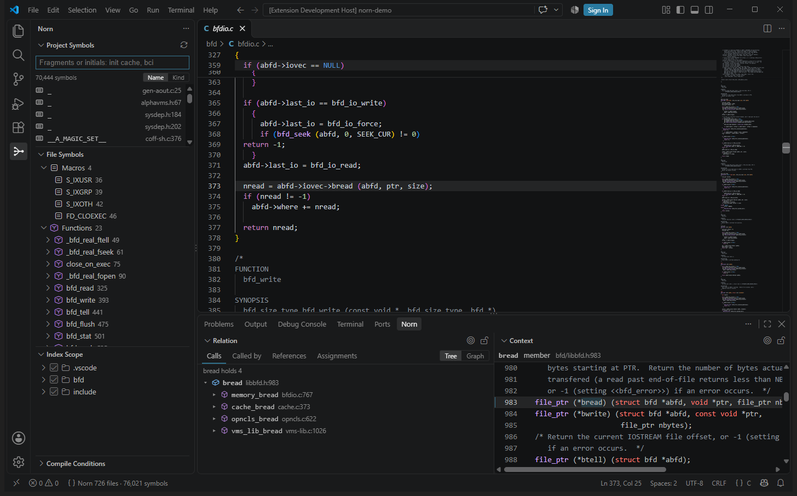

## Contents

1. [Requirements](#1-requirements)
2. [Installing](#2-installing)
3. [First use](#3-first-use)
4. [The views](#4-the-views)
5. [Searching for symbols](#5-searching-for-symbols)
6. [File Symbols](#6-file-symbols)
7. [Context: the definition](#7-context-the-definition)
8. [Relation: calls and references](#8-relation-calls-and-references)
9. [Index scope](#9-index-scope)
10. [Compile conditions](#10-compile-conditions)
11. [With the C/C++ extension (IntelliSense)](#11-with-the-cc-extension-intellisense)
12. [Keeping the index up to date](#12-keeping-the-index-up-to-date)
13. [Settings](#13-settings)
14. [Commands](#14-commands)
15. [Questions and answers](#15-questions-and-answers)
16. [Known limits](#16-known-limits)

---

## 1. Requirements

| | |
|---|---|
| Operating system | Windows, Linux or macOS, on x64 or Arm64 |
| VS Code | 1.85 or later (or an editor built on it that installs from Open VSX) |
| Languages | C (`.c`, `.h`), C++ (`.cpp`, `.cc`, `.cxx`, `.hpp`, `.hh` and the like) |
| Memory | A few hundred MB for most projects; about 6 GB while indexing something the size of the Linux kernel (60,000 files) |
| Other software | None. The indexer is inside the extension: no compiler, no clang |

Norn works offline and sends nothing anywhere.

## 2. Installing

### 2.1 From the Marketplace

In VS Code, open Extensions (`Ctrl+Shift+X`), search for **Norn**, and install
**Norn — Code Navigation & Symbol Index** (publisher `humphrey0925`). VS Code
installs the build for your platform.

### 2.2 From a `.vsix`

Each [release](https://github.com/humphrey0925/norn/releases) has a `.vsix` for
every platform (`norn-<version>-win32-x64.vsix`, `-linux-arm64`,
`-darwin-arm64`, …). Download the one for yours, then either:

- in Extensions, **…** (top right) → **Install from VSIX…**, and choose it; or
- `code --install-extension norn-0.23.0-win32-x64.vsix`

The release also has the indexer on its own (`norn-win32-x64.exe`,
`norn-linux-x64`, …), for scripts and other editors: see
[the command line](cli.md). The extension does not need it.

### 2.3 Checking it is installed

Search for `norn` in Extensions; its page should show the version you installed
(the picture was taken with 0.19.2):

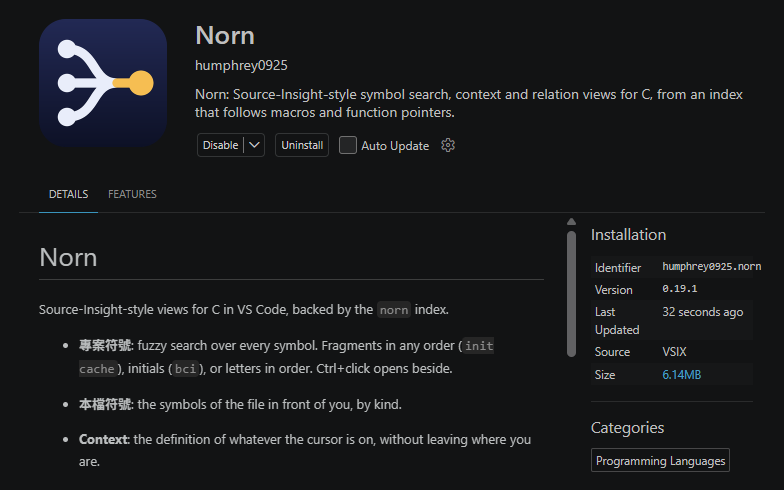

### 2.4 Upgrading from SI Code Index

Until 0.18.1 Norn was called SI Code Index. With a new name and identifier, VS
Code treats Norn as a different extension:

1. **Uninstall SI Code Index first**, then install Norn. With both installed,
   each builds an index of its own; Norn says so once when it sees it.
2. The rest happens by itself the first time a workspace is opened:
   - the workspace's `.si` folder is renamed `.norn` (settings and index kept);
   - the `si.*` settings you had are copied to `norn.*`.

## 3. First use

1. Open a **folder** with C sources in VS Code (File → Open Folder).
2. Open any `.c` or `.h` file: Norn starts.
3. The first time, it asks which of two:
   - **Index Everything**: the whole folder.
   - **Choose Folders First**: tick the folders to index in **Index Scope**,
     then apply. For a large project of which you only need a part.
4. The status bar, bottom left, shows the progress (`Norn parsing 420 / 726
   files`), then the number of files and symbols:


What you chose is kept in the workspace's `.norn/config.json`, and can be
changed in Index Scope at any time.

The index is kept in `.norn/cache/`: the next time the folder is opened it is
read back, and only the files that changed are read again. A folder opened
inside or around one already indexed takes what that index has of the files it
reads the same way. For an idea of the times:

| Project | First index | Opened again, ready to query |
|---|---|---|
| Redis (390,000 lines) | about 0.3 s | 0.03 s |
| binutils (2.1 million lines) | about 2.7 s | 0.06 s |
| Linux kernel (38 million lines) | about a minute | about 3 s |

> With Microsoft's C/C++ extension installed, it also asks whether Norn may
> configure IntelliSense: allow it. See [section 11](#11-with-the-cc-extension-intellisense).

## 4. The views

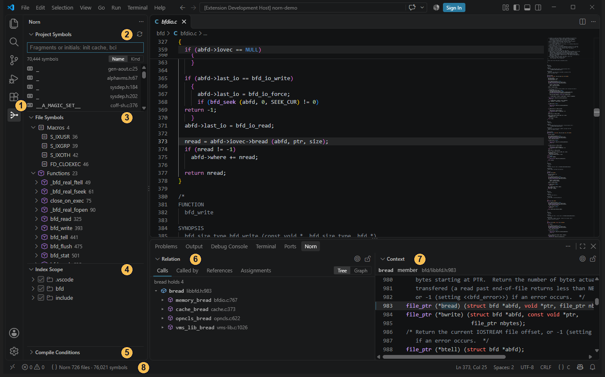

| # | Name | What it is for |
|---|---|---|
| 1 | Norn icon | In the activity bar: shows the Norn side bar |
| 2 | Project Symbols | Search the whole project's symbols |
| 3 | File Symbols | The symbols of the file in the editor, by kind |
| 4 | Index Scope | Which folders are indexed |
| 5 | Compile Conditions | Which macros are defined, which decides the `#if` branches indexed |
| 6 | Relation | Callers, callees and references of the symbol under the cursor |
| 7 | Context | The definition of the symbol under the cursor |
| 8 | Status bar | Files and symbols; click it to bring the index in line with the disk |

Relation and Context are in the **Norn** tab of the bottom panel. **They follow
the cursor**: put it on a name and both show that name, with no key to press.

Every view can be dragged where you like it. **Norn: Reset View Layout** puts
them all back.

## 5. Searching for symbols

Type in **Project Symbols**; the results follow as you type.


Any of three ways, in any case:

| Typed | Finds | How |
|---|---|---|
| `cache init` | `bfd_cache_init`, `init_section_cache` | Fragments, in any order |
| `bci` | `bfd_cache_init` | The first letters of the parts |
| `bfdcinit` | `bfd_cache_init` | Letters in order |

- **Click** a result: its definition opens in the editor.
- **Ctrl+click**: it opens in the editor group beside, leaving yours as it is.
- **Enter**: the first result opens.
- **Name / Kind** (top right): sort by name, or put functions, macros, types
  and variables apart.
- With nothing typed, every symbol of the project is listed, to scroll through.

**Norn: Search Symbols…** does the same with the word under the cursor already
typed.

## 6. File Symbols

**File Symbols** lists the macros, functions, types and variables of the file
in the editor, each with its line. Click one to go there.

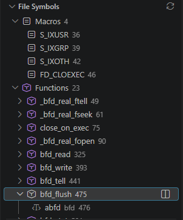

Open a function to see its **parameters and local variables**. To leave the
locals out, turn off `norn.fileSymbols.showLocals`.

## 7. Context: the definition

Put the cursor on any name and **Context** shows its definition, without moving
the file you are reading.

- It shows **the whole file the definition is in**, at the line of the
  definition: you can scroll and read, not edit.
- Its title says what it is (`function`, `macro`, `member`, `local variable`…)
  and where.
- **Ctrl+click** a name in Context to go on to that name's definition; hover
  over one for its description.
- The **lock** (top right) keeps Context where it is while the cursor moves,
  to read two places side by side. Click it again to let it follow.

On the right below is Context: the cursor is on `bread` in
`abfd->iovec->bread`, and Context shows the declaration of that member.

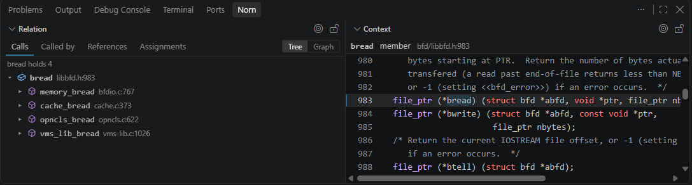

## 8. Relation: calls and references

**Relation** has four tabs, all about the symbol under the cursor.

### 8.1 Calls: what it calls

Every function the function calls, each opening onto what it calls in turn.

This works for **function pointers** too. In the picture above the cursor is
in `abfd->iovec->bread (...)`, a call through a member of a structure; Relation
shows "bread holds 4" and lists the four functions the program stores in that
member.

### 8.2 Called by: who calls it

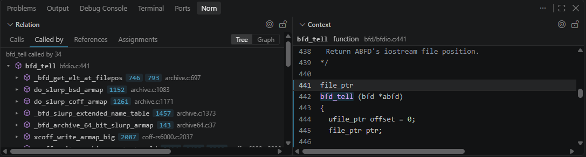

Each row is a caller, followed by the lines it calls on; click a line to go
there. Open a caller to follow its own callers.

Each call says how it is made: by name, through a macro, through a function
pointer, or uncertainly (in an `#if` branch the compile conditions do not
settle, say).

**Not only functions.** Variables, macros, members, enumerators and local
variables can be looked up too; Relation then lists where they are used:

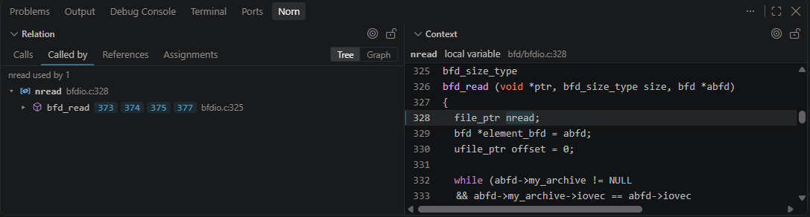

### 8.3 References: everywhere it appears

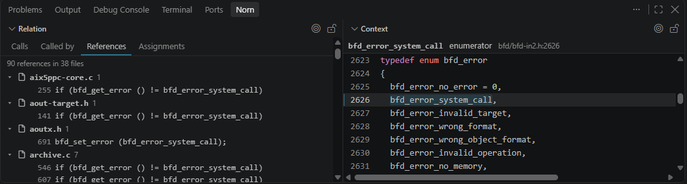

Every place it appears, by file. Above, the enumerator `bfd_error_system_call`:
90 references in 38 files. The list comes from Norn's index; no file is
searched.

**Click** a reference and Context shows the code around it while the editor
stays where it is, to go through them one by one; **double-click** or
**Enter** opens it in the editor, **Ctrl+click** in the editor group beside.

### 8.4 Assignments: where a function pointer is set

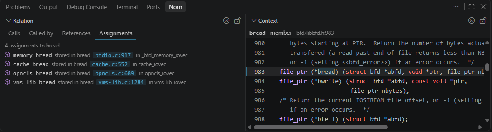

With the cursor on a member or variable that holds functions, this lists
**which functions are stored in it, and where**. With the cursor on a
function, it lists the members and variables it is stored in.

### 8.5 Tree and graph

**Tree / Graph** (top right) switches how it is shown.

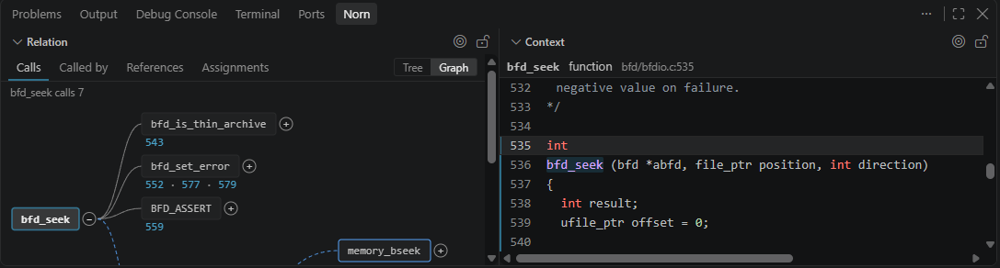

In the graph:

- **+ / −** beside a node opens or closes the next level.
- The number under an edge is the line; click it to go there.
- A **dashed** edge is a call through a function pointer.
- Scroll when the graph is larger than the view.

### 8.6 Lock and follow

- **Lock**: Relation stays on the symbol it shows while the cursor moves.
- **Follow once (target icon)**: while locked, shows the symbol now under the
  cursor and stays locked. For looking at one function at a time and moving on
  now and then.

### 8.7 The line above each function

Above each function's definition a line of small grey text gives the number
of its callers and callees; click it to open that list in Relation.


To hide it, turn off `norn.codeLens.enabled`.

## 9. Index scope

**Index Scope** lists the workspace's folders, each with a check box. The ticked
ones are indexed.

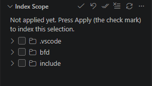

1. Tick or untick folders (open them for their subfolders).
2. Once something has changed, "Not applied yet" shows at the top: nothing has
   happened yet.
3. The **tick** in the toolbar applies it and indexes again; the **undo
   arrow** beside it drops the change.

The toolbar also ticks everything, unticks everything, and brings the index in
line with the disk. In the Explorer, a folder's context menu has **Norn: Index
This Folder / Exclude This Folder / Index Only This Folder**.

The scope is kept in `.norn/config.json`, which can go into version control for
everyone working on the project; `.norn/cache/` is the index and should not
(Norn writes a `.gitignore` that leaves it out).

## 10. Compile conditions

The `#if` and `#ifdef` that fill C code make one source compile to different
things in different configurations. Norn needs to know which macros are defined
to leave out of the index the branches that are not compiled.

### 10.1 Usually there is nothing to set

Norn **follows the build configuration it finds in the project**, up to three
folders down:

| From | Files |
|---|---|
| DS-5 / Arm Development Studio / Eclipse CDT | `.cproject` |
| Keil µVision | `.uvprojx`, `.uvproj` |
| IAR Embedded Workbench | `.ewp` |
| Visual Studio | `.vcxproj` |
| VS Code's C/C++ extension | `.vscode/c_cpp_properties.json` |
| A compilation database | `compile_commands.json`, `compile_flags.txt` |
| PlatformIO | `platformio.ini` |
| Make / CMake | `Makefile`, `*.mk`, `CMakeLists.txt` |
| Kconfig (Linux, U-Boot, Buildroot, BusyBox) | `include/generated/autoconf.h` or `.config`, in the tree or in a build folder of it (`make O=build`) |

Each build configuration in a project file (Debug, Release, each target)
becomes a set of conditions; the first is in force. For Kconfig, every
`CONFIG_` name the configuration does not set is taken as not set, as Kbuild
does.

With no build configuration at all, Norn still works out what it can: what the
sources themselves define holds; a branch it cannot decide is kept both ways,
and the calls in it are marked uncertain.

A branch certainly switched off (`#if 0`, or a condition on macros known to be
0 or undefined) is not indexed. With the cursor on one of its lines, Relation
and Context say "Not compiled: line N switched off by the compile conditions in
force", and Go to Definition and Find References find nothing: under these
conditions the names there stand for nothing.

The calls in a branch it cannot decide still show in Relation, marked in orange
"under #if (OPTION_A)", naming the `#if` they depend on; the line above the
function says so too ("3 callers (1 only if an undecided #if)"). It means Norn
does not know that macro's value: define or undefine it in Compile Conditions
(`OPTION_A=0`, say) and the branch is settled, the calls showing or going with
it.

> Of Makefiles and CMakeLists.txt only what is written out is read: `-D`
> outside any `ifdef` or `if()`, with a value no variable computes. Norn does
> not run them, so it reads less than the build has. A project file or a
> `compile_commands.json` is preferred where there is one.

### 10.2 What is in force

**Compile Conditions** lists every macro of the set in force, its value, and
who says so:

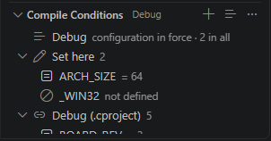

- The top row is **the set in force** (`Debug` in the picture).
- **Set here**: set by you in Norn; it comes first.
- **Debug (.cproject)**: read from the project file.
- **From the sources**: defined by the sources themselves, and certainly so.

### 10.3 Switching sets

Click **the set's name in the status bar**, or the top row of Compile
Conditions:

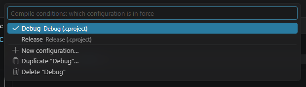

Switch to another set, make a new one, copy this one to change it, or delete
one. Norn indexes again under the set chosen.

### 10.4 Setting conditions by hand

**+** in the title of Compile Conditions, or these commands:

| Command | Does |
|---|---|
| Norn: Define a Macro for Conditions… | Defines a macro: `ARCH_SIZE=64`, or just `USE_NET` |
| Norn: Mark a Macro as Not Defined… | Says a macro is not defined |
| Norn: Read Conditions from a File… | Reads a header of `#define`s, or a Kconfig `.config` |
| Norn: Assume Names Are Not Defined… | Takes every name with a prefix (`CONFIG_`, say), or every name not defined, as not defined |

Right-click a row to remove it, or to override a value read from a project
file.

All of it is kept in `.norn/config.json`. Editing that file by hand works too:
Norn applies it when it is saved.

### Files the set in force does not read

A header no compilation unit reads under the set in force (one included only
from an `#if SOC == 2` that is certainly false, say) has its symbols left out
of Project Symbols, search, completion, Relation and the call hierarchy. Under
a set that reads it, they come back.

When the set comes from a build description (a DS-5 `.cproject`,
`c_cpp_properties.json`), a name it does not define and the sources do not
define is taken as not defined, as the compiler and IntelliSense take it; the
macros a compiler defines itself (`__CC_ARM`, `__GNUC__`, `_WIN32`…) stay
undecided.

## 11. With the C/C++ extension (IntelliSense)

With Microsoft's C/C++ extension (`ms-vscode.cpptools`) installed, Norn gives
it **the macro definitions and include paths in force** as they change, so that
IntelliSense's greying of uncompiled `#if` blocks and its navigation agree with
Norn.

1. The first time, the C/C++ extension asks whether Norn may configure
   IntelliSense for the folder: **allow** it.
2. From then on, a macro added in Norn, a set switched, or a change to
   `.norn/config.json` or `.cproject` reaches IntelliSense at once.

If you did not allow it, add to the workspace's `settings.json`:

```json
"C_Cpp.default.configurationProvider": "humphrey0925.norn"
```

The include paths are those of the build configuration and every indexed
folder that has headers. Nothing is written to any file.

> An older way: turn on `norn.conditions.updateCppProperties`, and Norn keeps a
> configuration named "Norn" in `.vscode/c_cpp_properties.json` for you to
> choose in the C/C++ extension. The way above is the one to use.

### Macro values and completion

- **A macro's value**: hover over a macro or an enum constant to see what it
  comes to, such as `BUF_Q3 = 4108 /* 0x100C */`. Norn expands the macros it
  uses in turn (`##` included), under the project's conditions and by the
  rules it decides `#if` with; casts are dropped or cut to their width, and
  enum constants are counted as C counts them. On a call of a macro with
  parameters (`BUF_Q(3)`) the arguments there are put in.
  - Where a variable or member is used, what can be worked out is, and the rest
    is left as an expression.
  - For a macro defined in the headers of several chips, the one read by the
    compilation units that read this file is chosen.
  - When it cannot be worked out, it says why (`Not expanded: X: 2
    definitions ...`).
  - Alongside the C/C++ extension, IntelliSense shows the definition and its
    expansion, and Norn adds a line with the value.
- **Completion**: as you type a name, Norn offers the functions, macros, types
  and variables of the index that match, beside the C/C++ extension's. Nothing
  needs building and no include path needs setting.

### Without IntelliSense

Without the C/C++ extension, or with its IntelliSense turned off
(`C_Cpp.intelliSenseEngine` set to `disabled`, then reload the window), Norn
gives what IntelliSense would, again with nothing built:

| | |
|---|---|
| Hover | Functions, variables and types: their declaration as written and the comment above it (the header's prototype's when the definition has none); parameters and locals: their declaration |
| Signature help | On `(` and `,`, the function's declaration with the current parameter marked |
| Completion | Members after `.` and `->`; the parameters and locals of the function; C keywords; `#include` paths |
| Highlighting | By what a name is: macro, function, type, global, parameter, local, member, enumerator |
| Folding | Braces, each branch of an `#if`, comments of several lines, runs of `#include` |
| Rename (`F2`) | Every spelling of the same thing; a static function or variable only in its own file; macros and global names also in `#if` branches the set in force switches off |
| Parameter names | Shown before the arguments of a call; turn off `editor.inlayHints.enabled` to hide them |
| Dimming uncompiled lines | See `norn.dimInactive` |
| Formatting | With clang-format installed (with LLVM, say): the project's `.clang-format`, or Visual Studio's style |

With or without IntelliSense: an `#include` opens on a click, F12 opens the
file; the other uses of the name under the cursor are highlighted; and where a
name is used that no header read declares, the light bulb offers "Add
#include".

Norn does not underline compile errors: only a compiler can tell them.

## 12. Keeping the index up to date

| When | Norn |
|---|---|
| A file is saved in VS Code | Updates the index (about 20 ms on Redis, 90 ms on binutils) |
| Files are changed, added or deleted outside VS Code (`git pull`, say) | Sees it and updates |
| `.norn/config.json` or the project's build files change | Applies it |
| The index seems not to match the files | Click "Norn … files" in the status bar, or **Norn: Sync Index with Disk** |
| To start again from nothing | **Norn: Discard the Saved Index and Rebuild** |

Reopening a large project, Norn answers at once from what it saved last time
while it checks in the background for files that changed; the status bar shows
a spinner meanwhile.

## 13. Settings

Search for `norn` in VS Code's settings.

| Setting | Default | |
|---|---|---|
| `norn.serverPath` | empty | Empty uses the indexer inside the extension. Give a full path only to use one you built |
| `norn.cache.enabled` | on | Keep the index on disk, so that a reopened workspace only reads what changed |
| `norn.cache.directory` | empty | Where the index is kept; empty is `.norn/cache` in the workspace |
| `norn.codeLens.enabled` | on | The line above each function with its callers and callees |
| `norn.fileSymbols.showLocals` | on | Parameters and locals under each function in File Symbols |
| `norn.conditions.updateCppProperties` | off | Keep a "Norn" configuration in `c_cpp_properties.json` (see section 11) |
| `norn.dimInactive` | auto | Dim the lines the set in force does not compile. auto: when the C/C++ extension does not; always; never |
| `norn.includeAliases` | empty | Headers the build makes from a template, as `made=template`, such as `bfd.h=bfd-in2.h` |

## 14. Commands

`Ctrl+Shift+P`, then type `Norn` for all of them. The ones used most:

| Command | Does |
|---|---|
| Norn: Search Symbols… | Search, with the word under the cursor typed |
| Norn: Show Callers / Show Calls / Show References | Relation on the callers, callees or references of the symbol under the cursor |
| Norn: Show Function Pointer Assignments | Where function pointers are set |
| Norn: Show Relation as a Tree / as a Graph | Switch between tree and graph |
| Norn: Lock Relation / Lock Context | Stop following the cursor |
| Norn: Sync Index with Disk | Bring the index in line with the disk |
| Norn: Restart Index | Restart the indexer; only what changed is read again |
| Norn: Discard the Saved Index and Rebuild | Throw the saved index away and index from nothing |
| Norn: Switch Compile Configuration… | Switch the set of compile conditions |
| Norn: Open the Scope File | Open `.norn/config.json` |
| Norn: Reset View Layout | Put every Norn view back where it started |
| Norn: Switch Header/Source | Between a header and the source of the same name; `Alt+O` without the C/C++ extension |

The others have no key; give them one in Keyboard Shortcuts (`Ctrl+K Ctrl+S`),
searching for `Norn`.

Norn is a standard language server too, so VS Code's own commands work: `F12`
Go to Definition, `Shift+F12` Find All References, `Ctrl+T` symbols by name,
`Ctrl+Shift+O` symbols of the file, and the call hierarchy.

## 15. Questions and answers

**The status bar says "Norn not running"**

- If the message says the built-in server is missing, antivirus software may
  have removed `norn.exe` from the extension. Reinstall the extension and make
  an exception for it; or download the indexer for your platform from the
  [release](https://github.com/humphrey0925/norn/releases), keep it somewhere,
  and give its full path in `norn.serverPath`.
- Check that `norn.serverPath` does not name a file that is gone; empty uses
  the built-in one.

**Two sets of views, or the index built twice**

SI Code Index is still installed. Uninstall it in Extensions.

**"Access denied" when saving compile conditions**

Since 0.18.0, when `.norn/config.json` is read-only (as version control often
leaves files) or hidden, Norn makes it writable and writes it. If it still
happens, the message gives the file's path: check that you may write to it.

**A function's callers are missing, or include some that should not be there**

Usually the compile conditions:

- Missing: the call may be in an `#if` branch the set in force does not
  compile. Check in Compile Conditions that the set in force is the one you
  want.
- Too many: without a build configuration, branches that cannot be decided are
  kept both ways. Give it one (section 10), or define the macros by hand.

**IntelliSense disagrees with Norn**

Check that the C/C++ extension takes its configuration from Norn (section 11).

**The index takes too much memory or time**

Untick in Index Scope the folders you do not need: third-party libraries, test
data, other platforms' code.

**Sharing the settings with others**

Put `.norn/config.json` in version control: it has the scope and the compile
conditions.

**The index looks wrong; to rebuild it all**

**Norn: Discard the Saved Index and Rebuild**.

## 16. Known limits

- C++ is less accurate than C: constructors called through an implicit
  conversion, and the chains of `operator<<` of test frameworks, are often
  missed or marked uncertain.
- An `#if` branch that neither a build configuration nor the sources settle is
  kept both ways, and the calls in it are marked uncertain.
- Of Makefiles and CMakeLists.txt only the `-D` written out are read: fewer
  definitions than the build has.
- Keil, IAR, Visual Studio and PlatformIO project files have only been tested
  on sample projects; please report one that is not read.
- A project the size of the Linux kernel needs about 6 GB of memory while it is
  indexed, and 4–5 GB after.

---

The pictures are of GNU binutils' `bfd/` and `include/` folders (726 files,
about 76,000 symbols).
