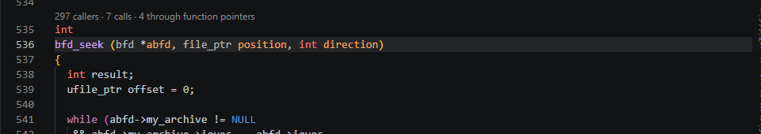
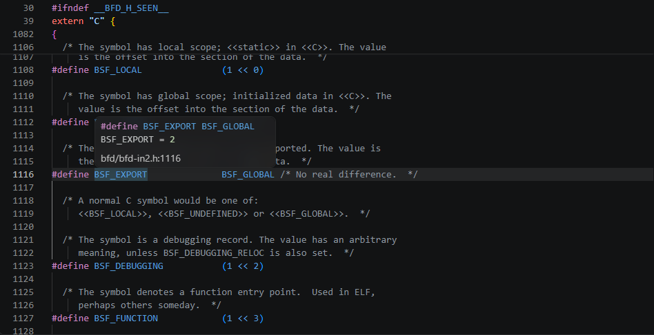
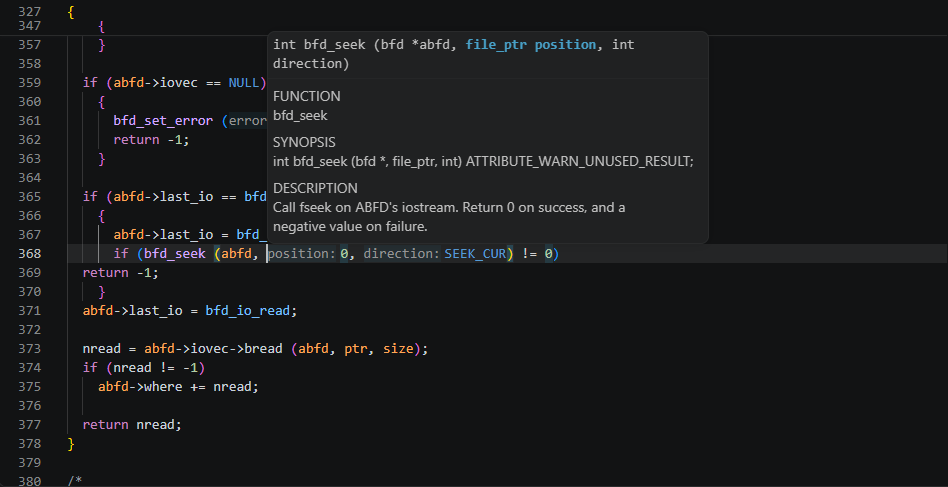
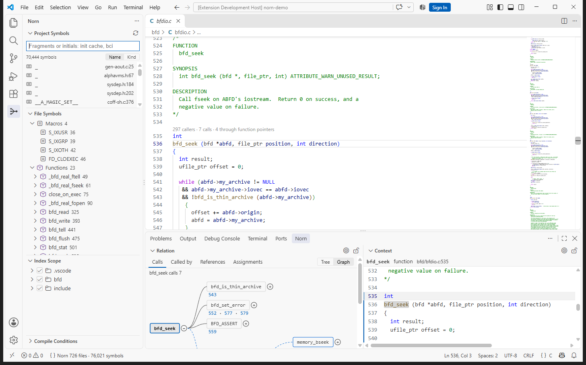

# Norn — Code Navigation & Symbol Index

**Source Insight-style navigation for large C codebases, in VS Code.**
Open a folder and Norn indexes it: no build, no `compile_commands.json`, no
configuration. It follows calls through macros and function pointers, and it
knows which `#if` branches your build actually compiles.

Norn is built for the code where language servers struggle: firmware and
embedded C, SDKs with a header per chip, vendor trees that only build with a
proprietary toolchain, kernels, and anything too large or too old to have a
working compilation database.

- **Fast.** The whole Linux kernel indexes in about a minute on a desktop
  PC; saving a file updates the index in tens of milliseconds. The index is cached, so reopening a
  workspace is instant, and opening a folder inside or around one already indexed reuses that index.
- **Accurate.** Checked call by call against clang on public projects: on
  Redis, 99.3% of calls found with 99.8% precision; on STM32F4 HAL, 96.5%
  found with 100% precision.
- **Local.** Everything runs on your machine. Norn makes no network
  connections and collects no data.

## Features

### Project Symbols: find anything

Fuzzy search over every function, macro, type, variable and member in the
workspace. Type fragments in any order (`cache init`), initials (`bci`), or
letters in order. Ctrl+click opens the result beside the current editor.

### Relation: callers, callees, references

Who calls this function, what it calls, where a name is referenced, and where a
function pointer is assigned. Expand level by level as a tree, or see it as a
graph. Each edge says how the call happens: directly, through a macro, through
a function pointer, or only under an `#if` the build may not compile.

### Context: the definition, without leaving your place

The definition of whatever is under the cursor, in a read-only panel beside
your code. Hover, Ctrl+click and find-references work there as in the editor.
Relation and Context follow the cursor until you lock them.

### File Symbols, with parameters and locals

The symbols of the current file by kind. A function's parameters and local
variables are listed under it; select one to see its declaration and every line
that uses it.

### Callers and callees above each function

### Compile conditions: the code your build compiles

Norn reads the build's own description and works out which `#if` branches are
compiled. Code that is switched off is left out of search, relations and
navigation, and dimmed in the editor. It understands:

- Arm DS-5 / Arm Development Studio / Eclipse CDT `.cproject`
- Keil µVision `.uvprojx`, IAR `.ewp`, Visual Studio `.vcxproj`
- `compile_commands.json`, `compile_flags.txt`, `platformio.ini`
- VS Code's `c_cpp_properties.json`
- a Kconfig build's configuration (Linux, U-Boot, Buildroot): `include/generated/autoconf.h`
  or `.config`, in the tree or a build folder of it
- Makefiles and `CMakeLists.txt` (the definitions they state outright)
- the compiler a build uses (GCC, Clang, Arm Compiler 5 and 6, IAR, MSVC) and what it
  predefines

A project with several configurations (Debug, Release, one per board) gets one
set of conditions each; the status bar shows the one in force and switches
between them. Macros can also be set by hand.

Hovering a macro shows the value it works out to under those conditions,
even through several levels of macros, casts and token pasting.

### A complete C editor, with or without the C/C++ extension

Norn is a full language server. Go to Definition, Find References, workspace
and document symbols and Call Hierarchy all use its index.

If Microsoft's C/C++ extension is installed, Norn gives it the compile
conditions in force (as its configuration provider), so IntelliSense agrees
with Norn about which code is compiled. Norn's hover then adds only what
IntelliSense does not show: a macro's value.

If the C/C++ extension is not installed, or its IntelliSense is turned off
(`"C_Cpp.intelliSenseEngine": "disabled"`), Norn provides the editing features
itself:

| Feature | |
|---|---|
| Hover | Declarations with their doc comments; macro values |
| Completion | Members after `.` and `->`, locals, keywords, `#include` paths, every indexed name |
| Signature help | The parameters of the call being typed |
| Semantic highlighting | Macros, functions, types, globals, parameters, locals and members, each coloured by kind |
| Rename | Every spelling of the name, including in `#if` branches the current configuration switches off |
| Inlay hints | Parameter names at call sites |
| Folding | Blocks, `#if` branches, comments, runs of `#include` |
| Formatting | With clang-format, when it is installed |
| Quick fix | Adds the `#include` that declares a name |

## Getting started

1. Install the extension.
2. Open a folder containing C sources.

The status bar shows progress while the first index is built. Nothing else
has to be set up. AI agents in VS Code, such as Copilot's agent mode, get the
same index as tools (callers and callees through macros and function
pointers, a definition's source, which lines are compiled) by themselves;
for Claude Code, Codex and OpenCode, run **Norn: Connect AI Agents** once
([Norn for AI agents](https://github.com/humphrey0925/norn/blob/master/docs/agents.md)). To index only part of a large tree, use the **Index Scope**
view to choose the folders.

Norn includes its index server for Windows (x64, Arm64), Linux (x64, Arm64;
any distribution) and macOS (Intel and Apple silicon).

## Settings

| Setting | Default | |
|---|---|---|
| `norn.codeLens.enabled` | `true` | Caller and callee counts above each function |
| `norn.relation.click` | `auto` | What one click on a Relation row does: `auto` shows a reference in Context and opens the rest; `context` shows every row in Context (double click opens); `editor` opens every row |
| `norn.conditions.followBuildConfig` | `true` | With no configuration of its own, follow the first build configuration found in the workspace; off indexes with no compile conditions |
| `norn.fileSymbols.showLocals` | `true` | Parameters and locals under functions in File Symbols |
| `norn.dimInactive` | `auto` | Dim lines the current configuration does not compile (`auto`: when the C/C++ extension does not) |
| `norn.cache.enabled` | `true` | Keep the index on disk, so a workspace reopens instantly |
| `norn.cache.directory` | | Where the index is kept (default: `.norn/cache` in the workspace) |
| `norn.mcp.enabled` | `true` | Offer the index's tools to AI agents in VS Code, such as Copilot's agent mode (VS Code 1.101 or later) |
| `norn.includeAliases` | | Headers the build generates from a template, e.g. `bfd.h=bfd-in2.h` |
| `norn.serverPath` | | Use your own build of the server instead of the bundled one |

Run **Norn: …** commands from the Command Palette. In C files, F12, Ctrl+F12
and Shift+F12 go to definitions, implementations and references through Norn,
and Alt+O switches between header and source when the C/C++ extension is not
installed.

## Limitations

- Norn does not compile your code, so it shows no compiler errors or
  warnings.
- C is the main focus. C++ is indexed too (classes, methods, namespaces,
  virtual calls), but templates are only partly understood.

## License

Apache License 2.0. Third-party components and their licenses are listed in
`THIRD_PARTY_NOTICES.txt`.

Source Insight is a trademark of Source Dynamics, Inc. Norn is not affiliated with,
or endorsed by, Source Dynamics; the name is used only to describe the style of
navigation. Other names are trademarks of their owners.
